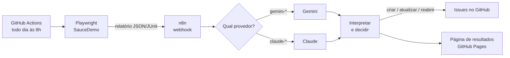

# Triagem de falhas de teste com IA

> **In English:** when an automated UI test fails, an n8n workflow sends the error, stack trace, test code and screenshot to an LLM (Gemini by default, Claude optional). The model decides whether it is a product bug, a flaky test or a broken test, and opens or updates a GitHub issue without duplicates. It runs daily on GitHub Actions against a public demo store, with planted failures and an answer key, so the accuracy shown on the results page is measured, not claimed.

**[Ver os resultados ao vivo](https://luizhenrisouto.github.io/triagem-de-falhas-ia/)** · **[Issues abertas pela IA](https://github.com/luizhenrisouto/triagem-de-falhas-ia/issues?q=label%3Atriagem-ia)** · **[Fluxo do n8n](n8n/fluxo.json)**

## O problema

Quando um teste automatizado falha, alguém precisa abrir o log, olhar o print, decidir se é defeito do produto, instabilidade do ambiente ou erro do próprio teste e, se for defeito, escrever o registro com passos, esperado e obtido. Na minha experiência como QA, isso leva uns **30 minutos por falha**. Com uma suíte grande, a triagem toma a manhã.

## O que este projeto faz

1. Uma suíte Playwright roda todo dia no GitHub Actions contra o [SauceDemo](https://www.saucedemo.com), uma loja feita para treino de QA.
2. As falhas vão para um **fluxo no n8n**, que manda para a IA o erro, o stack, o trecho do código do teste e o print da tela.
3. A IA devolve um JSON validado com a categoria (`bug_produto`, `teste_instavel` ou `teste_quebrado`), passos para reproduzir, esperado, obtido, causa provável e sugestão de correção.
4. O n8n decide o que fazer no GitHub:
   - **bug do produto** ou **teste quebrado**: abre uma issue já escrita;
   - se a mesma falha já tem issue aberta, só atualiza o contador e a última ocorrência; se a issue foi fechada e a falha voltou, reabre com um comentário;
   - **teste instável**: não abre issue.
5. O resultado de cada execução vai para uma [página pública](https://luizhenrisouto.github.io/triagem-de-falhas-ia/), com acerto contra o gabarito, tempo, custo e horas economizadas.



## Como saber se a IA acertou

As falhas são **plantadas de propósito** e a resposta certa está em [`testes/gabarito.json`](testes/gabarito.json):

| Teste | Usuário do SauceDemo | O que acontece | Categoria certa |
| --- | --- | --- | --- |
| imagem de cada produto corresponde ao produto | `problem_user` | todas as fotos iguais | bug do produto |
| campo sobrenome aceita texto no checkout | `problem_user` | o campo não aceita texto | bug do produto |
| finalizar compra conclui o pedido | `error_user` | o pedido não é concluído | bug do produto |
| catálogo abre em tempo aceitável | `performance_glitch_user` | ora passa, ora estoura o tempo | teste instável |
| remover produto esvazia o carrinho | `standard_user` | o teste usa um seletor que não existe | teste quebrado |

Os nomes dos testes não entregam a resposta. A IA recebe só o que um QA receberia: erro, stack, código do teste, print e se o teste passou numa nova tentativa.

**Horas economizadas** = falhas *diferentes* triadas × 30 minutos (estimativa minha, rotulada como estimativa na página; uma falha que se repete em vários dias conta uma vez) − todo o tempo gasto pela automação. **Acerto** = falhas com a categoria certa ÷ todas as falhas do gabarito, somando as execuções. Quando o provedor de IA falha (por exemplo, sobrecarregado), a falha conta como erro, nunca como acerto.

## Como usar na sua empresa

O fluxo não depende do SauceDemo. Ele recebe qualquer relatório **JSON do Playwright** ou **JUnit XML** (Cypress, Selenium, Rest Assured, pytest e quase toda ferramenta geram JUnit).

1. Copie para o seu repositório as pastas `n8n/`, `scripts/`, `src/`, `prompts/`, os arquivos `package.json`, `package-lock.json` e `tsconfig.json`, e o arquivo [`exemplos/usar-na-sua-empresa.yml`](exemplos/usar-na-sua-empresa.yml) para `.github/workflows/`.
2. Troque no workflow o passo de testes pelo da sua suíte e aponte `--relatorio` para o arquivo que ela gera.
3. Crie o segredo `GEMINI_API_KEY` (em [aistudio.google.com/apikey](https://aistudio.google.com/apikey)) ou `ANTHROPIC_API_KEY` com a variável `MODELO_IA` igual a um modelo `claude-...`. No nível gratuito do Gemini, o Google pode usar o conteúdo enviado para melhorar os produtos dele: com logs e prints de sistemas internos, use uma conta paga ou o Claude.
4. Ajuste o prompt em [`prompts/triagem.md`](prompts/triagem.md) com o jeito de trabalhar do seu time.

Se a empresa já tem um n8n hospedado, importe `n8n/fluxo.json` nele e use `N8N_URL` apontando para ele. Nesse caso, prefira as credenciais do próprio n8n em vez de variáveis de ambiente.

### Configuração

| Nome | Tipo | Padrão | Para quê |
| --- | --- | --- | --- |
| `GEMINI_API_KEY` | segredo | | chave do Gemini |
| `ANTHROPIC_API_KEY` | segredo | | chave do Claude (opcional) |
| `MODELO_IA` | variável | `gemini-3.5-flash-lite` | modelo usado; `claude-*` usa o Claude |
| `ISSUE_PREFIXO_TITULO` | variável de ambiente | vazio | texto no início do título das issues |
| `ISSUE_RODAPE` | variável de ambiente | vazio | texto extra no fim de cada issue |
| `LIMITE_CATALOGO_MS` | variável | `5165` | calibra o teste instável da demonstração |

## O que acontece quando algo trava

- Cada etapa tem limite de tempo: subir o n8n (5 min), enviar ao n8n (10 min), job de triagem (30 min), publicação (10 min). A IA tem até 5 tentativas por falha quando está ocupada.
- Um **vigia** ([`.github/workflows/vigia.yml`](.github/workflows/vigia.yml)) roda de hora em hora: cancela execução presa na fila há mais de 30 min ou rodando há mais de 60, dispara outra, e abre uma issue com o rótulo `vigia` se a última execução falhou ou se nenhuma deu certo nas últimas 26 h. Quando tudo volta ao normal, ele comenta e fecha o alerta.

## Rodar localmente

Requer Node 24.

```bash
npm ci
npx playwright install chromium
npm test                 # testes unitários
npm run test:integracao  # sobe um n8n real com servidores falsos de IA e GitHub
npm run n8n:local        # abre o fluxo no editor do n8n em http://localhost:5678
```

## Ferramentas

- **n8n**: orquestração (webhook, escolha do provedor, chamadas HTTP, decisões, respostas)
- **Gemini** (padrão, nível gratuito) e **Claude** (opcional): triagem com saída JSON estruturada e leitura do print
- **Playwright**: suíte de testes e relatórios
- **GitHub Actions** e **GitHub Pages**: execução diária e página de resultados
- **Claude Code**: o projeto inteiro foi construído com desenvolvimento assistido por IA, com testes antes do código

## Como foi testado

- 86 testes unitários (leitura de relatórios, impressão digital da falha, chamadas às duas IAs, tratamento de recusa, JSON inválido, erro 503 e cota, decisão das issues, menções neutralizadas, métricas, histórico e as decisões do vigia)
- 8 testes de integração que sobem um n8n de verdade com servidores falsos: criar, não duplicar, reabrir, erro isolado, troca de provedor, nova tentativa por falha quando a IA está ocupada e nenhuma issue criada quando a listagem do GitHub falha

---

Feito por [Luiz Henri Souto](https://github.com/luizhenrisouto).
